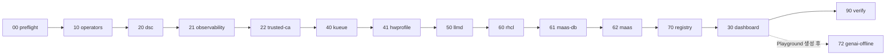

# RHOAI 3.4.2 폐쇄망 기능 활성화 가이드

대상: OpenShift 4.20.x(llm-d는 4.20 이상 필수), `rhods-operator.3.4.2`, 미러 레지스트리 사용 폐쇄망.
실행 위치: 폐쇄망 관리 호스트, cluster-admin. 모든 명령은 툴킷 루트에서 실행한다.

## 0. 시작 전에

**완료 기준은 "메뉴가 보인다"가 아니라 "사용자가 기능을 실제로 쓴다"다.** 각 단계의 확인 항목과 6절 검증표로 판정한다.

3.4.2에서 반드시 알아야 할 것:

| 항목 | 내용 |
| --- | --- |
| MaaS 경로 | DSC `spec.components.kserve.modelsAsService.managementState`. upstream 가이드의 `aigateway`는 3.4.2 스키마에 없다(BC 실측) |
| `disableTrustyBiasMetrics` | `false`를 명시하면 MCP 메뉴가 사라진다(BC 재현). 툴킷은 이 필드를 쓰지 않는다 |
| MaaS 모델 | LLMInferenceService(llm-d) 모델만 MaaS에 공개된다(RHOAIENG-37667). 기존 vLLM InferenceService는 재배포가 필요하다 |
| Authorino 중복 | RHOAI 2.x 시절의 `redhat-ods-applications-auth-provider/authorino`가 남아 있으면 재부팅 후 MaaS가 401로 실패한다(TS-19). preflight가 잡는다 |
| Kueue | RHBoK 1.3 + DSC `kueue: Unmanaged`. 1.4 이상은 Trainer와 비호환 |
| Dashboard 플래그 표기 | `vLLMDeploymentOnMaaS`(문서 표의 `vLLMDeploymentOnMaas`가 아님. BC 적용 확인) |

## 1. 설정

```bash
cp config/env.example.sh config/env.sh
```

`config/env.sh`에서 최소한 다음을 확인한다.

| 변수 | 3.4.2 값 예시 | 확인 방법 |
| --- | --- | --- |
| `RHOAI_VERSION` | `3.4.2` | `oc get csv -n redhat-ods-operator \| grep rhods` |
| `CATALOG_SOURCE` | `cs-redhat-operator-index` | `oc get catalogsource -n openshift-marketplace` |
| `STORAGE_CLASS` | `ontap-iscsi` | DB는 block 계열 권장 |
| `MAAS_TLS_CERT_FILE` / `KEY_FILE` | `/root/certs/maas.crt` | SAN = `maas.<apps 도메인>` |
| `LLMD_TLS_CERT_FILE` / `KEY_FILE` | `/root/certs/inference.crt` | SAN = `inference-gateway.<apps 도메인>` |
| `GATEWAY_ACCESS_LABEL` | `platform.bcnuri.com/maas-gateway-access` | 기존 Gateway가 있으면 스크립트가 selector에서 자동으로 읽는다 |
| `MODEL_NAMESPACES` | `model-test,llm-models` | 모델 배포 namespace |
| `KUEUE_NAMESPACES` | `team-a` | Kueue를 쓸 프로젝트 |
| `INTERNAL_CA_FILE` | `/root/certs/corp-ca.pem` | 내부 S3·레지스트리가 사설 CA일 때 |
| `MR_DB_HOST` 외 | 기존 Registry DB | 비우면 Registry 인스턴스 생성 생략 |

## 2. 전체 흐름



| 단계 | 하는 일 | 클러스터 영향 |
| --- | --- | --- |
| preflight | 버전·카탈로그·IDMS·DSC·충돌 조건 점검, 현재 상태 저장 | 없음 |
| operators | cert-manager, LWS(+CR), RHCL, RHBoK, JobSet(+CR), COO·OTel·Tempo, (NFD·GPU) | 신규 오퍼레이터 Pod. 기존 구독은 건드리지 않음 |
| dsc | 컴포넌트 Managed, TrustyAI LMEval `deny/deny`, Kueue `Unmanaged` | 컴포넌트 컨트롤러 기동 |
| observability | UWM, DSCI monitoring(metrics·traces) | monitoring namespace에 스택 생성 |
| trusted-ca | 사내 CA를 DSCI customCABundle에 추가 | 각 프로젝트 `odh-trusted-ca-bundle` 갱신 |
| kueue | Kueue 인스턴스, ResourceFlavor·ClusterQueue `default`, LocalQueue, namespace label | 해당 프로젝트 작업이 큐로 관리됨 |
| hwprofile | GPU Hardware Profile(Kueue 큐 또는 nodeSelector) | 없음 |
| llmd | GatewayClass, `openshift-ai-inference` Gateway(ClusterIP+Route) | openshift-ingress에 Envoy Pod |
| rhcl | Kuadrant, `AUTH_SERVICE_TIMEOUT=2s`, Authorino TLS·CA, KServe 컨트롤러 재시작 | Authorino 재기동 |
| maas-db | PostgreSQL(PVC, PV Retain), `maas-db-config` | DB Pod |
| maas | `maas-default-gateway`, DSC MaaS, maas-api 확인, MaaS 메뉴, 호출 확인 | maas-api·정책 생성 |
| registry | ModelRegistry 인스턴스(외부 DB), Catalog URI 점검 | Registry Pod |
| dashboard | 나머지 메뉴 플래그 | 없음(화면만) |
| genai-offline | Llama Stack 서버에 HF 오프라인 env | Playground 서버 Pod 재시작 |
| verify | 상태 요약, Wasm 로드, 실패 Pod | 없음 |

## 3. 단계별 실행

먼저 전체를 dry-run으로 돌려 API 서버 검증 결과를 본다.

```bash
./scripts/rhoai-enable.sh preflight
./scripts/rhoai-enable.sh all          # DRY_RUN=true: 변경 없음. [WARN] dry-run 실패는 앞 단계 미적용 때문인지 확인
```

이후 단계별로 실제 적용한다. 단계마다 확인 항목을 통과한 뒤 다음으로 간다.

### 3.1 오퍼레이터

```bash
DRY_RUN=false APPROVE_INSTALLPLAN=true ./scripts/rhoai-enable.sh operators
```

- `APPROVE_INSTALLPLAN=true`는 이 툴킷이 만든 구독의 InstallPlan만 승인한다. `openshift-operators`는 여러 오퍼레이터의 InstallPlan이 묶일 수 있으므로 출력된 CSV 목록을 확인한다.
- 확인: `oc get csv -A | grep -E 'cert-manager|leader-worker|rhcl|kueue|job|observability|opentelemetry|tempo'` 가 모두 `Succeeded`.
- RHCL이 1.4.0이면 중단된다. 1.4.2 이상으로 올린다.

### 3.2 DSC·관측·CA

```bash
DRY_RUN=false ./scripts/rhoai-enable.sh dsc
DRY_RUN=false ./scripts/rhoai-enable.sh observability trusted-ca
```

- 내장 Kueue가 `Managed`이면 kueue 항목을 건너뛴다. 공식 migration 절차 후 `KUEUE_MIGRATION_ACK=true`로 다시 실행한다.
- JobSet CRD가 없으면 trainer를 건너뛴다.
- 확인: `oc get dsc default-dsc -o jsonpath='{.status.conditions}' | jq` 에서 False인 항목의 message. `cluster-monitoring-config`가 이미 있으면 `enableUserWorkload: true`를 직접 추가하라는 경고가 나온다(기존 설정 보호).

### 3.3 Kueue·Hardware Profile

```bash
DRY_RUN=false KUEUE_NAMESPACES=team-a ./scripts/rhoai-enable.sh kueue hwprofile
```

- ClusterQueue 이름은 DSC 기본값과 같은 `default`다. quota는 `KUEUE_*_QUOTA`.
- MIG를 쓰면 `GPU_RESOURCE_NAME`을 노드 allocatable 이름으로 바꾼다: `oc get node <gpu노드> -o jsonpath='{.status.allocatable}' | jq`
- 확인: Dashboard 새 Workbench 화면에서 GPU profile 선택 → Pod가 `kueue.x-k8s.io/queue-name=default`로 admitted.

### 3.4 llm-d

```bash
DRY_RUN=false ./scripts/rhoai-enable.sh llmd
```

- 확인: `oc get gateway openshift-ai-inference -n openshift-ingress` 가 `PROGRAMMED=True`, `curl -k https://inference-gateway.<도메인>/` 가 404(라우트 없음)로 응답.
- 모델 배포: Dashboard 배포 마법사에서 **Distributed inference with llm-d** 선택, 또는 `manifests/llmd/llminferenceservice-sample.yaml`을 내부 값으로 바꿔 적용.

### 3.5 MaaS

```bash
DRY_RUN=false ./scripts/rhoai-enable.sh rhcl
DRY_RUN=false ./scripts/rhoai-enable.sh maas-db
DRY_RUN=false ./scripts/rhoai-enable.sh maas
```

- `rhcl`: Authorino CR이 kuadrant-system 외에도 있으면 중단한다(TS-19). 사용처를 확인해 정리한 뒤 `AUTHORINO_DUP_ACK=true`.
- `maas-db`: 기존 `maas-postgresql` Secret이 있으면 비밀번호를 그대로 쓴다(TS-17). 운영은 `MAAS_DB_MODE=external` 권장.
- `maas`: 마지막에 `GET /maas-api/v1/models`가 200이면 기반 구성이 끝난 것이다.

모델 공개와 호출 확인:

```bash
# 1) LLMInferenceService의 router.gateway.refs 를 maas-default-gateway 로 배포
# 2) manifests/maas/samples/maas-access-sample.yaml 값을 바꿔 적용(MaaSModelRef → Subscription → AuthPolicy)
HOST=https://maas.$(oc get ingresses.config cluster -o jsonpath='{.spec.domain}')
API_KEY=$(curl -sk -X POST "$HOST/maas-api/v1/api-keys" \
  -H "Authorization: Bearer $(oc whoami -t)" -H 'Content-Type: application/json' \
  -d '{"name":"verify","expiresIn":"1h"}' | jq -r .key)
curl -sk "$HOST/maas-api/v1/models" -H "Authorization: Bearer $API_KEY" | jq '.data[] | {id, url}'
MODEL_URL=$(curl -sk "$HOST/maas-api/v1/models" -H "Authorization: Bearer $API_KEY" | jq -r '.data[0].url')
MODEL_ID=$(curl -sk "$HOST/maas-api/v1/models" -H "Authorization: Bearer $API_KEY" | jq -r '.data[0].id')
curl -sk "$MODEL_URL/v1/chat/completions" -H "Authorization: Bearer $API_KEY" -H 'Content-Type: application/json' \
  -d "{\"model\":\"$MODEL_ID\",\"messages\":[{\"role\":\"user\",\"content\":\"hello\"}],\"max_tokens\":20}" | jq .
```

- 키 없이 호출 → 401, AuthPolicy에 없는 그룹 → 403, quota 초과 → 429인지도 확인한다.

### 3.6 Model Registry·Dashboard·Playground

```bash
DRY_RUN=false ./scripts/rhoai-enable.sh registry
DRY_RUN=false ./scripts/rhoai-enable.sh dashboard        # 한 필드씩 확인하려면 STEPWISE=true
# Gen AI Studio > Playground 생성 후
DRY_RUN=false ./scripts/rhoai-enable.sh genai-offline
./scripts/rhoai-enable.sh verify
```

- `dashboard`는 이미 같은 값인 필드를 빼고 바뀌는 필드만 patch한다. 결과는 `evidence/*/dashboard.after.json`.
- `STEPWISE=true`는 필드를 하나씩 적용하고 브라우저 확인을 기다린다. 메뉴가 사라지는 회귀를 찾을 때 쓴다.

## 4. 3.4.2 Dashboard 플래그 (툴킷 적용 값)

| 그룹 | 플래그 | 조건 |
| --- | --- | --- |
| 공통 | `disableTracking: true`, `disableModelCatalog`·`disableKServeMetrics`·`disablePerformanceMetrics`·`disableDistributedWorkloads: false` | 항상 |
| 기능 | `disableModelRegistry`·`disableModelRegistrySecureDB`·`disablePipelines`·`disableFeatureStore`·`disableNIMModelServing: false` | 해당 FEATURE |
| Gen AI | `genAiStudio`, `aiAssetCustomEndpoints: true` | GENAI |
| 학습 | `disableKueue: false`, `trainingJobs: true` | KUEUE, TRAINER |
| llm-d | `disableLLMd: false`, `llmGatewayField`, `deploymentWizardYAMLViewer: true` | LLMD |
| 평가·관측 | `disableLMEval: false`, `observabilityDashboard: true` | TRUSTYAI, OBSERVABILITY |
| TP | `projectRBAC`, `promptManagement`, `automl`, `autorag: true` | PREVIEW |
| DP | `mcpCatalog`, `externalVectorStores: true` | DEV_PREVIEW |
| MaaS(62) | `modelAsService`, `maasAuthPolicies`, `vLLMDeploymentOnMaaS: true` | MAAS |
| 쓰지 않음 | `disableTrustyBiasMetrics`, `mlflow`, `disableFineTuning`, `disableHardwareProfiles`, `disableAcceleratorProfiles`, `disableModelMesh` | — |

## 5. 기능별 후속 작업 (백엔드 인스턴스)

메뉴가 켜진 뒤 사용하려면 아래가 필요하다.

| 기능 | 할 일 |
| --- | --- |
| Pipelines | 프로젝트 > Pipelines > Configure pipeline server(내부 S3, 사설 CA면 trusted-ca 적용 확인) |
| MLflow·프롬프트 관리 | MLflow 인스턴스(내부 DB·S3). `promptManagement`는 Playground의 MLflow 연결까지 확인 |
| Feature Store | 프로젝트에 FeatureStore CR(내부 Git의 feature 정의) |
| TrustyAI bias | 모델 namespace에 TrustyAIService 생성(모델 Pod 자동 재기동 — 작업 시간에) |
| Eval Hub | EvalHub 배포와 평가 이미지·데이터셋 반입 전에는 메뉴만 보인다 |
| MCP | MCP 서버 이미지 반입 전에는 메뉴만 보인다. Playground 도구 호출은 vLLM tool-calling 인자 필요 |
| AutoML/AutoRAG | pipelines-components 저장소·PyPI 미러, 공식 수정 파이프라인 정의(RHOAIENG-64768) |
| NIM | NGC 이미지·모델 캐시 반입 후 Applications에서 연동 |

## 6. 검증표

| ID | 시나리오 | 기대 결과 |
| --- | --- | --- |
| V01 | 일반 사용자 로그인, 프로젝트 생성 | 허용 메뉴만 보임 |
| V02 | GPU profile로 Workbench 생성·재시작 | 파일 유지, GPU 인식 |
| V03 | Pipeline 실행 | run 성공, S3 artifact 재조회 |
| V04 | Registry 모델 등록·재조회 | 버전 조회 |
| V05 | KServe 모델 배포·토큰 호출 | 200, 무토큰 401 |
| V06 | llm-d 모델 replica 2 + scheduler | 요청 분산(BC 23번 문서 방식) |
| V07 | MaaS key 발급·호출·quota | 200 / 401 / 403 / 429 |
| V08 | Playground 대화 | 응답, 서버 로그에 HF 접속 시도 없음 |
| V09 | Kueue 큐 admitted | Workload admitted, quota 초과 시 대기 |
| V10 | 관측 대시보드 | 모델 요청 후 메트릭 증가 |
| V11 | 재부팅 후 `verify` | TS-19/TS-20 항목 정상 |

## 7. 롤백

```bash
ls evidence/                                    # 실행 시각별 백업
./scripts/99-rollback.sh dashboard evidence/<시각>/backup-odhdashboardconfig-odh-dashboard-config-redhat-ods-applications.yaml
./scripts/99-rollback.sh dsc evidence/<시각>/backup-datasciencecluster-default-dsc.yaml   # 컴포넌트가 Removed로 돌아가면 리소스가 삭제될 수 있음
```

Gateway·DB·큐·Secret은 롤백 스크립트가 지우지 않는다. 필요하면 이름을 확인해 개별 삭제한다. DB PV는 Retain이므로 PVC를 지워도 데이터는 남는다.

## 8. 근거

- RHOAI 3.4 문서: Installing (disconnected), Customizing the dashboard, Govern LLM access with MaaS, Deploy models using distributed inference with llm-d, Managing workloads with Kueue, Release notes
- Red Hat 지원 구성표: https://access.redhat.com/articles/rhoai-supported-configs-3.x
- BC 3.4.2 실측·트러블슈팅: `RHOAI가능활성화/` (dashboard-config-matrix, rhoai-toolkit-guides 00·20·21·22)
- RHOAI-Toolkit: `install-rhoai-34.sh`, `enable-dashboard-features.sh`, `setup-maas.sh`
